# Техническое задание
## Чат-бот «Школьный штаб» для мессенджера MAX

**Версия:** 1.0  
**Дата:** 11.10.2026  

---

## 1. Общее описание

### 1.1. Что это

Чат-бот в мессенджере MAX для школьников, их учителей, родителей и школьных психологов.

### 1.2. Проблема

Школьник тонет в хаосе:
- расписание в одном месте,
- домашка в другом,
- дедлайны контрольных никто не отслеживает.

Из-за этого — срывы, тревога, выгорание. Особенно остро в 8–9 классах, когда нагрузка резко растёт.

Когда накрывает стресс — некуда обратиться за быстрой поддержкой. Всё разрознено и только усиливает напряжение.

### 1.3. Решение

Единое окно в MAX с четырьмя ролями:

| Роль | Что делает |
|------|-----------|
| Ученик | Управляет учёбой, следит за дедлайнами, работает со стрессом |
| Учитель | Загружает домашку, расписание, объявления для класса |
| Родитель | Видит учебную картину ребёнка |
| Психолог | Получает сигналы о стрессе — только с согласия ученика |

### 1.4. Главная фишка

ИИ-бот замечает признаки стресса в общении с учеником и **аккуратно** предлагает обратиться к школьному психологу. Психолог **не видит переписку** — только обезличенный сигнал. Ученик сам выбирает: переписка или живой разговор.

### 1.5. Целевая аудитория

| Кто | Возраст | Боль |
|-----|---------|------|
| Основная: школьники 7–11 классов | 13–17 | Не успевают, забывают, тревожатся |
| Вторичная: учителя | — | Класс неорганизован, сложно доносить информацию |
| Третичная: родители | — | Не видят, справляется ли ребёнок |
| Четвёртая: психологи | — | Не видят, кому нужна помощь, пока не поздно |

---

## 2. Технический стек

- **Python** 3.11+
- **MAX Bot API** — библиотека **[РЕШИТЬ: maxapi / aiomax / своя обёртка на aiohttp]**
- **SQLAlchemy 2.0** (async) + **SQLite** для MVP
- **Alembic** — миграции
- **APScheduler** — напоминания
- **pydantic** — валидация и настройки
- **python-dotenv** — .env
- **loguru** — логи
- **pytest** — тесты

---

## 3. Структура проекта

### 3.1. Схема верхнего уровня

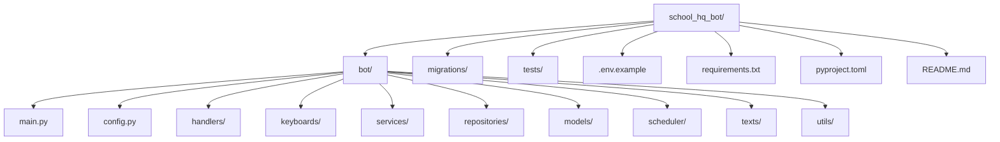

### 3.2. Схема модуля bot/

```mermaid
graph TD
    BOT["bot/"]
    
    BOT --> H["handlers/"]
    BOT --> KB["keyboards/"]
    BOT --> S["services/"]
    BOT --> REP["repositories/"]
    BOT --> M["models/"]
    BOT --> SCH["scheduler/"]
    BOT --> T["texts/"]
    BOT --> U["utils/"]
    
    H --> H1["start.py"]
    H --> H2["onboarding.py"]
    H --> H3["student/"]
    H --> H4["teacher/"]
    H --> H5["parent/"]
    H --> H6["psychologist/"]
    
    H3 --> H31["schedule.py"]
    H3 --> H32["homework.py"]
    H3 --> H33["deadlines.py"]
    H3 --> H34["antistress.py"]
    H3 --> H35["profile.py"]
    H3 --> H36["psychologist.py"]
    
    H4 --> H41["homework.py"]
    H4 --> H42["schedule.py"]
    H4 --> H43["announcements.py"]
    
    H5 --> H51["summary.py"]
    H6 --> H61["signals.py"]
    
    S --> S1["user_service.py"]
    S --> S2["schedule_service.py"]
    S --> S3["homework_service.py"]
    S --> S4["deadline_service.py"]
    S --> S5["mood_service.py"]
    S --> S6["points_service.py"]
    S --> S7["breathing_service.py"]
    S --> S8["stress_service.py"]
    S --> S9["ai_service.py"]
    
    M --> M1["user.py"]
    M --> M2["schedule.py"]
    M --> M3["homework.py"]
    M --> M4["deadline.py"]
    M --> M5["mood.py"]
    M --> M6["reward.py"]
    M --> M7["stress.py"]
    
    REP --> R1["user_repo.py"]
    REP --> R2["schedule_repo.py"]
    REP --> R3["homework_repo.py"]
    REP --> R4["deadline_repo.py"]
    REP --> R5["mood_repo.py"]
    REP --> R6["reward_repo.py"]
    REP --> R7["stress_repo.py"]
    
    SCH --> SC1["setup.py"]
    SCH --> SC2["jobs.py"]
    
    T --> T1["ru.py"]
    T --> T2["breathing.py"]
    T --> T3["antistress_cards.py"]
    
    U --> U1["time_parser.py"]
    U --> U2["validators.py"]
```

### 3.3. Полное дерево

```
school_hq_bot/
├── bot/
│   ├── __init__.py
│   ├── main.py
│   ├── config.py
│   ├── handlers/
│   │   ├── __init__.py
│   │   ├── start.py
│   │   ├── onboarding.py
│   │   ├── student/
│   │   │   ├── schedule.py
│   │   │   ├── homework.py
│   │   │   ├── deadlines.py
│   │   │   ├── antistress.py
│   │   │   ├── profile.py
│   │   │   └── psychologist.py
│   │   ├── teacher/
│   │   │   ├── homework.py
│   │   │   ├── schedule.py
│   │   │   └── announcements.py
│   │   ├── parent/
│   │   │   └── summary.py
│   │   └── psychologist/
│   │       └── signals.py
│   ├── keyboards/
│   │   ├── __init__.py
│   │   ├── main_menu.py
│   │   ├── student_kb.py
│   │   ├── teacher_kb.py
│   │   ├── parent_kb.py
│   │   └── psychologist_kb.py
│   ├── services/
│   │   ├── __init__.py
│   │   ├── user_service.py
│   │   ├── schedule_service.py
│   │   ├── homework_service.py
│   │   ├── deadline_service.py
│   │   ├── mood_service.py
│   │   ├── points_service.py
│   │   ├── breathing_service.py
│   │   ├── stress_service.py
│   │   └── ai_service.py
│   ├── repositories/
│   │   ├── __init__.py
│   │   ├── base.py
│   │   ├── user_repo.py
│   │   ├── schedule_repo.py
│   │   ├── homework_repo.py
│   │   ├── deadline_repo.py
│   │   ├── mood_repo.py
│   │   ├── reward_repo.py
│   │   └── stress_repo.py
│   ├── models/
│   │   ├── __init__.py
│   │   ├── base.py
│   │   ├── user.py
│   │   ├── schedule.py
│   │   ├── homework.py
│   │   ├── deadline.py
│   │   ├── mood.py
│   │   ├── reward.py
│   │   └── stress.py
│   ├── scheduler/
│   │   ├── __init__.py
│   │   ├── setup.py
│   │   └── jobs.py
│   ├── texts/
│   │   ├── __init__.py
│   │   ├── ru.py
│   │   ├── breathing.py
│   │   └── antistress_cards.py
│   └── utils/
│       ├── __init__.py
│       ├── time_parser.py
│       └── validators.py
├── migrations/
├── tests/
│   ├── test_user_service.py
│   ├── test_homework_service.py
│   └── test_stress_service.py
├── .env.example
├── requirements.txt
├── pyproject.toml
└── README.md
```
---

## 4. Модели данных

Все модели — таблицы в базе данных. Каждая отвечает за свой кусок информации.
Связи между ними описаны в конце раздела.

### 4.1. User — пользователь

**Зачем:** хранит всех, кто пользуется ботом. Ученик, учитель, родитель и психолог — все они User, но с разной ролью.

| Поле | Тип | Описание |
|------|-----|----------|
| id | int | Внутренний номер в базе |
| max_user_id | str | ID из MAX (уникальный) |
| role | str | student / teacher / parent / psychologist |
| name | str \| None | Имя |
| grade | int \| None | Класс (только для ученика) |
| school | str \| None | Школа |
| points | int | Очки (по умолчанию 0) |
| created_at | datetime | Когда зарегистрировался |
| state | str \| None | Текущее состояние в диалоге (FSM) |
| child_id | int \| None | Для родителя: на кого смотрит |
| classes | str \| None | Для учителя: какие классы ведёт |
| school_id | str \| None | Для психолога: к какой школе привязан |

**Нюансы:**
- `max_user_id` уникален — по нему бот понимает, кто пишет.
- `role` задаётся один раз при онбординге.
- `state` нужен, чтобы бот помнил, что он сейчас спрашивает.

**Связи:** один User → много ScheduleItem, Homework, Deadline, MoodEntry, Reward, ChatMessage.

### 4.2. ScheduleItem — урок в расписании

**Зачем:** хранит расписание ученика. Один урок = одна запись.

| Поле | Тип | Описание |
|------|-----|----------|
| id | int | Номер записи |
| user_id | int | Чей это урок |
| day_of_week | int | День недели (1–7) |
| time | time | Во сколько |
| subject | str | Предмет |
| room | str \| None | Кабинет |
| created_by | int | Кто добавил: ученик или учитель |

**Нюансы:**
- `created_by` важен: если урок добавил учитель, ученик не может его удалить.
- `day_of_week`: 1 — понедельник, 7 — воскресенье.

**Связи:** много ScheduleItem → один User.

### 4.3. Homework — домашка

**Зачем:** хранит задания. Одно задание = одна запись.

| Поле | Тип | Описание |
|------|-----|----------|
| id | int | Номер |
| user_id | int | Чья домашка |
| subject | str | Предмет |
| description | str | Что задали |
| deadline | datetime | Когда сдать |
| status | str | active / done |
| created_by | int | Кто добавил: ученик или учитель |
| class_name | str \| None | Если от учителя — какому классу |
| created_at | datetime | Когда добавили |

**Нюансы:**
- `status`: active — не сделана, done — выполнена.
- `class_name`: если учитель загрузил домашку для 9А, она автоматически появляется у всех учеников 9А.
- При `status = done` начисляется +10 очков.

**Связи:** много Homework → один User.

### 4.4. Deadline — контрольная

**Зачем:** отдельно от домашки. Контрольная — это событие с датой.

| Поле | Тип | Описание |
|------|-----|----------|
| id | int | Номер |
| user_id | int | Чей |
| title | str | Что за контрольная |
| date | datetime | Когда |
| kind | str | контрольная / зачёт / экзамен |
| created_by | int | Кто добавил |
| class_name | str \| None | Если от учителя |

**Нюансы:**
- Отдельная модель, потому что у контрольной нет `status` и она требует обратного отсчёта.
- Родителю приходит уведомление о контрольной, о домашке — нет.

**Связи:** много Deadline → один User.

### 4.5. MoodEntry — запись настроения

**Зачем:** хранит ответы на опрос «Как ты сегодня?».

| Поле | Тип | Описание |
|------|-----|----------|
| id | int | Номер |
| user_id | int | Чей |
| date | date | Дата |
| score | int | Оценка 1–5 |
| comment | str \| None | Комментарий |
| created_at | datetime | Когда записали |

**Нюансы:**
- Эти данные **не передаются родителю или учителю**. Только сам ученик.
- Психолог видит их только если ученик согласился.
- Используются для дневника настроения и для анализа ИИ.

**Связи:** много MoodEntry → один User.

### 4.6. Reward — награда

**Зачем:** хранит, какие награды ученик открыл за очки.

| Поле | Тип | Описание |
|------|-----|----------|
| id | int | Номер |
| user_id | int | Чей |
| item_key | str | avatar_rocket / frame_gold / color_neon |
| unlocked_at | datetime | Когда открыл |

**Нюансы:**
- `item_key` — уникальный идентификатор награды.
- Одна и та же награда не может быть куплена дважды.

**Связи:** много Reward → один User.

### 4.7. StressSignal — сигнал о стрессе

**Зачем:** главная фишка продукта. Когда ИИ замечает, что ученику плохо, и ученик соглашается передать это психологу — создаётся StressSignal.

| Поле | Тип | Описание |
|------|-----|----------|
| id | int | Номер |
| student_id | int | Кто (ссылка на User) |
| psychologist_id | int | Кому (ссылка на User) |
| created_at | datetime | Когда создан |
| risk_level | int | Уровень стресса 1–5 |
| themes | str \| None | Темы: «усталость, конфликты» |
| status | str | pending / in_progress / closed |
| consent | bool | True только если ученик согласился |
| preferred_format | str \| None | chat / live / None |

**Что НЕ передаётся психологу:**
- Переписка ученика.
- Дневник настроения.
- Цитаты.

**Нюансы:**
- `consent` — этический предохранитель. Без согласия сигнал не создаётся.
- `preferred_format` — как связаться: переписка или живая встреча.
- `status`: pending — новый, in_progress — в работе, closed — закрыт.

**Связи:** много StressSignal → один ученик и один психолог.

### 4.8. ChatMessage — сообщение в чате

**Зачем:** хранит сообщения ученика **локально** для анализа ИИ. Психологу они **не передаются**.

| Поле | Тип | Описание |
|------|-----|----------|
| id | int | Номер |
| user_id | int | Чей |
| text | str | Текст сообщения |
| risk_score | int \| None | Оценка 1–5 (посчитал ИИ) |
| themes | str \| None | Темы |
| created_at | datetime | Когда |

**Нюансы:**
- Эти сообщения **не отдаются психологу**. Только для локального анализа.
- Логика: если `risk_score ≥ 4` два дня подряд → бот предлагает помощь.

**Связи:** много ChatMessage → один User.

### 4.9. Схема связей

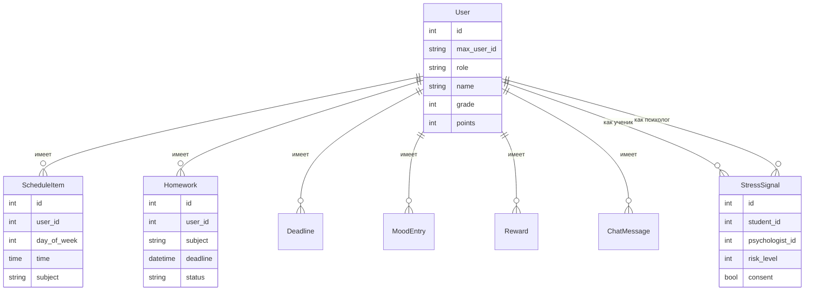

### 4.10. Что важно для разработчика

1. **`max_user_id` уникален** — по нему бот находит пользователя.
2. **`role` задаётся один раз** при онбординге.
3. **`consent` в StressSignal** — обязательное поле. Без `True` сигнал не создаётся.
4. **ChatMessage не отдаётся психологу** — только для локального анализа.
5. **MoodEntry не отдаётся родителю и учителю** — только ученику и психологу (с согласия).
6. **`created_by`** в ScheduleItem, Homework, Deadline — чтобы отличать, кто добавил.
7. **`class_name`** — чтобы домашка и контрольные от учителя автоматически появлялись у всего класса.

---
## 5. Роли и онбординг

### 5.1. Стартовое окно

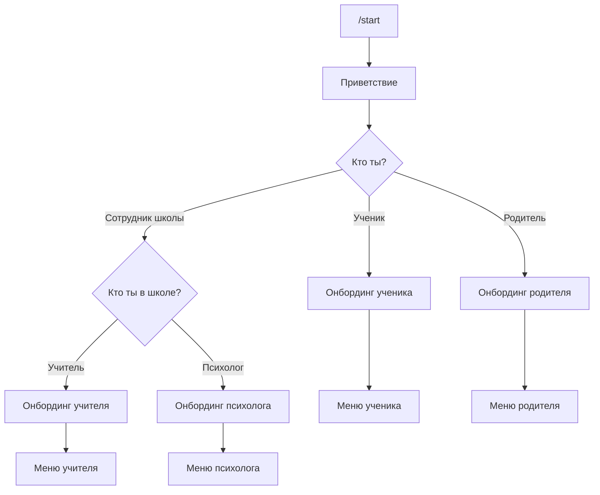

**Текст диалога:**

```
Бот: Привет! Я — Школьный штаб 👋
Помогу с учёбой и поддержу, если будет тяжело.
Кто ты?
[🎓 Я ученик]
[👩‍🏫 Я сотрудник школы]
[👨‍👩‍👧 Я родитель]
```

### 5.2. Если «сотрудник школы»

```
Бот: Кто ты в школе?
[👩‍🏫 Учитель]
[🧠 Психолог]
```

### 5.3. Онбординг ученика

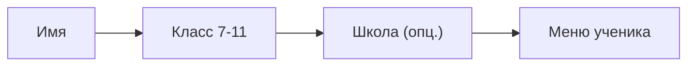

### 5.4. Онбординг учителя

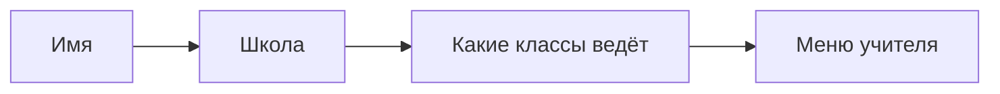

### 5.5. Онбординг родителя

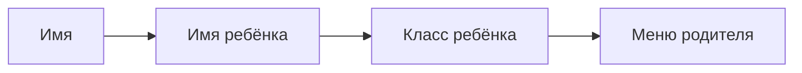

### 5.6. Онбординг психолога

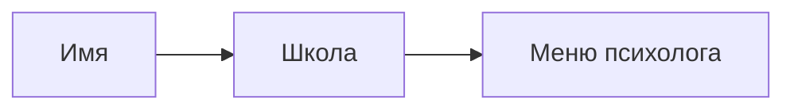

---

## 6. Функции по ролям

### 6.1. Кабинет ученика

```mermaid
graph TD
    ST["Ученик"] --> R1["📚 Расписание"]
    ST --> R2["📝 Домашка"]
    ST --> R3["⏰ Дедлайны"]
    ST --> R4["🧘 Антистресс"]
    ST --> R5["🎮 Профиль и очки"]
    ST --> R6["⚙️ Настройки"]
    
    R1 --> R11["Сегодня / завтра / неделя"]
    R1 --> R12["Добавить урок"]
    R1 --> R13["Удалить урок"]
    
    R2 --> R21["Список активной"]
    R2 --> R22["Добавить"]
    R2 --> R23["Отметить выполненной +10"]
    
    R3 --> R31["Ближайшие контрольные"]
    R3 --> R32["Обратный отсчёт"]
    
    R4 --> R41["Опрос настроения"]
    R4 --> R42["Дневник настроения"]
    R4 --> R43["Дыхательные практики"]
    R4 --> R44["Антистресс-карточки"]
    R4 --> R45["Чат с ИИ-ботом"]
    
    R5 --> R51["Баланс очков"]
    R5 --> R52["Кастомизация"]
    R5 --> R53["Список наград"]
```

#### Расписание
- Просмотр на сегодня / завтра / неделю
- Добавление урока: день, время, предмет, кабинет
- Удаление урока
- Просмотр расписания, загруженного учителем

#### Домашка
- Список активной домашки
- Добавление: предмет, описание, дедлайн
- Отметка «выполнено» → +10 очков
- Просмотр домашки от учителя

#### Дедлайны
- Список ближайших контрольных
- Добавление: предмет, дата, тип
- Обратный отсчёт

#### Антистресс
- Опрос «Как ты сегодня?» — шкала 1–5
- Дневник настроения — история за 7/14 дней
- Дыхательные практики: квадратное дыхание, 4-7-8
- Антистресс-карточки: 5–10 текстов на 1–2 минуты
- Чат с ИИ-ботом для поддержки

#### Поддержка психолога

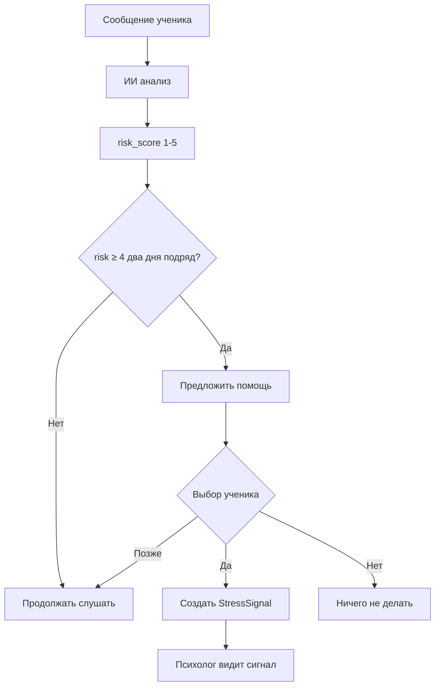

#### Геймификация

| Действие | Очки |
|----------|------|
| Отметил домашку выполненной | +10 |
| Прошёл дыхательную практику | +5 |
| Заполнил настроение | +3 |
| Добавил урок в расписание | +2 |

#### Профиль и настройки
- Имя, класс, школа
- Баланс очков
- Включение/выключение напоминаний
- Время опроса настроения

---

### 6.2. Кабинет учителя

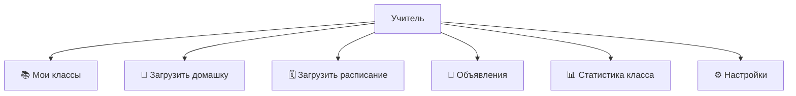

**Что может:**
- Просмотр своих классов
- Загрузка домашки для класса: предмет, задание, дедлайн
- Загрузка расписания для класса
- Добавление контрольных
- Отправка объявлений классу
- Статистика класса: кто сдал домашку, кто нет

**Не видит:** настроение, очки, переписку, сигналы о стрессе.

---

### 6.3. Кабинет родителя

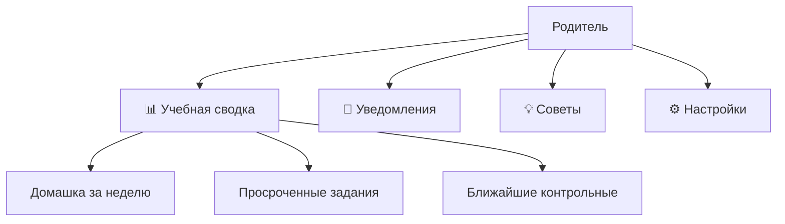

**Что видит:**
- Учебная сводка по ребёнку: сколько домашки выполнено за неделю, просроченные задания, ближайшие контрольные
- Уведомления: «Завтра контрольная по алгебре», «У ребёнка 3 просроченных задания»
- Короткие советы по поддержке подростка

**Не видит:** настроение, очки, переписку, сигналы о стрессе.

---

### 6.4. Кабинет психолога

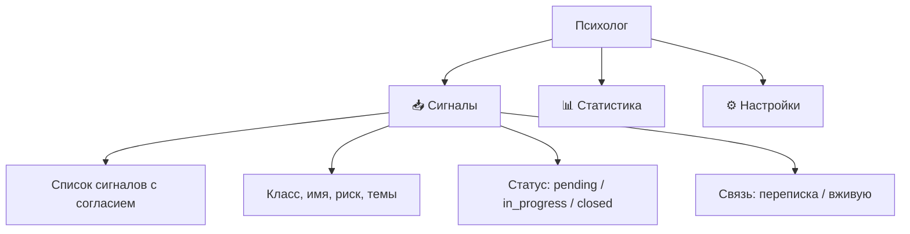

**Что видит:**
- Список сигналов с согласием ученика
- Каждый сигнал: класс, имя, уровень стресса, темы, дата
- Отметка статуса
- Связь с учеником: переписка или живая встреча
- Статистика обращений

**Не видит:** переписку ученика с ботом, дневник настроения без согласия.

---

## 7. ИИ-анализ стресса

### 7.1. Как работает

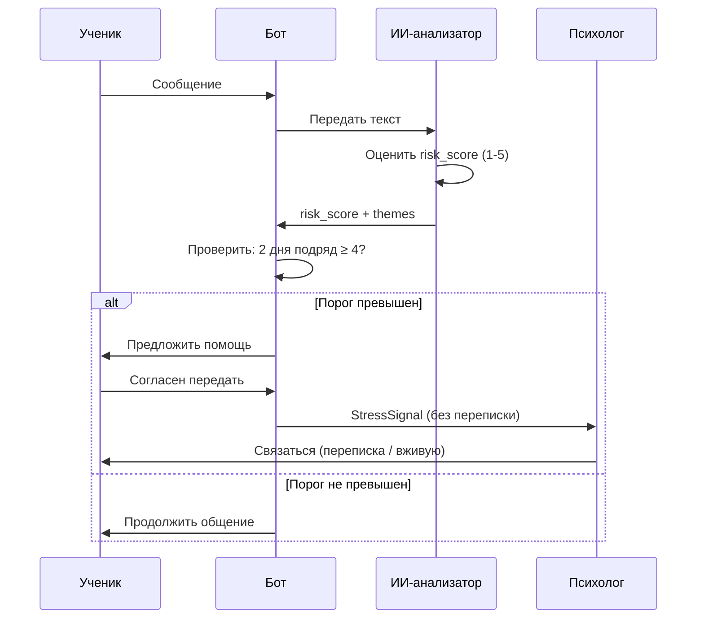

### 7.2. Красные флаги

- «ненавижу»
- «не могу больше»
- «устал»
- «всё бесит»
- «не вижу смысла»
- «одиноко»
- «страшно»
- «никому не нужен»

**[РЕШИТЬ: расширить список]**

### 7.3. Реализация для MVP

- **Вариант А:** простой анализатор на ключевых словах + счётчик
- **Вариант Б:** готовая LLM через API — точнее, но нужен токен

**[РЕШИТЬ: какой вариант]**

### 7.4. Диалог предложения помощи

```
Бот: Я вижу, что последние дни тебе тяжело.
Это нормально — иногда всем бывает сложно.
Хочешь, я передам школьному психологу, что ты не против поговорить?
Он не увидит наши сообщения — только то, что тебе нужна поддержка.
[💬 Да, передать психологу]
[🤝 Хочу поговорить вживую]
[✍️ Хочу переписываться]
[⏳ Позже]
[❌ Нет, спасибо]
```

---

## 8. Напоминания (APScheduler)

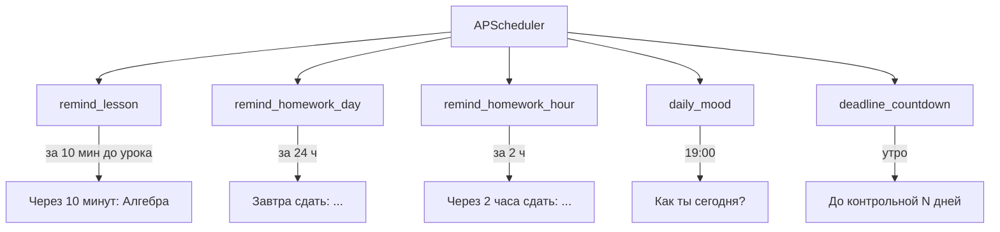

**[РЕШИТЬ: точные интервалы]**

---

## 9. Сервисы

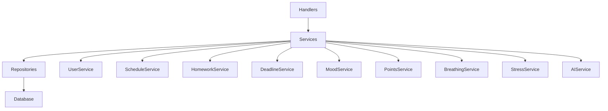

### 9.1. UserService
- `get_or_create(max_user_id) -> User`
- `set_role(user, role)`
- `complete_onboarding(user, data)`
- `get_profile(user_id)`

### 9.2. ScheduleService
- `add_item(user_id, day, time, subject, room)`
- `get_today(user_id) -> list`
- `get_tomorrow(user_id)`
- `get_week(user_id)`
- `delete_item(item_id)`

### 9.3. HomeworkService
- `add(user_id, subject, description, deadline)`
- `list_active(user_id)`
- `mark_done(homework_id)` → начисляет очки
- `get_overdue(user_id)`

### 9.4. DeadlineService
- `add(user_id, title, date, kind)`
- `list_upcoming(user_id)`
- `get_countdown(deadline_id)`

### 9.5. MoodService
- `save_mood(user_id, score, comment)`
- `get_history(user_id, days=14)`
- `get_average(user_id, days=7)`

### 9.6. PointsService
- `add_points(user_id, amount, reason)`
- `spend_points(user_id, amount, item_key)`
- `get_balance(user_id)`

### 9.7. BreathingService
- `get_scenario(key) -> list[Step]`
- `run_scenario(user_id, key)`

### 9.8. StressService
- `analyze_message(user_id, text) -> risk_score, themes`
- `check_threshold(user_id) -> bool`
- `create_signal(student_id, psychologist_id, consent, format)`
- `get_signals(psychologist_id)`
- `update_status(signal_id, status)`

### 9.9. AIService
- `get_response(user_id, text) -> str`
- `analyze(text) -> risk_score, themes`

---

## 10. Главное меню по ролям

### Ученик

```
📚 Расписание
📝 Домашка
⏰ Дедлайны
🧘 Антистресс
🎮 Профиль и очки
⚙️ Настройки
```

### Учитель

```
📚 Мои классы
📝 Загрузить домашку
🗓 Загрузить расписание
📢 Объявления
📊 Статистика класса
⚙️ Настройки
```

### Родитель

```
📊 Учебная сводка
🔔 Уведомления
💡 Советы
⚙️ Настройки
```

### Психолог

```
📥 Сигналы
📊 Статистика
⚙️ Настройки
```

---

## 11. Переменные окружения

`.env.example`:

```
MAX_BOT_TOKEN=your_token_here
DATABASE_URL=sqlite+aiosqlite:///./school_hq.db
LOG_LEVEL=INFO
TZ=Europe/Moscow
AI_API_KEY=your_ai_key_here
AI_MODEL=gpt-4o-mini
```

---

## 12. Этапы разработки

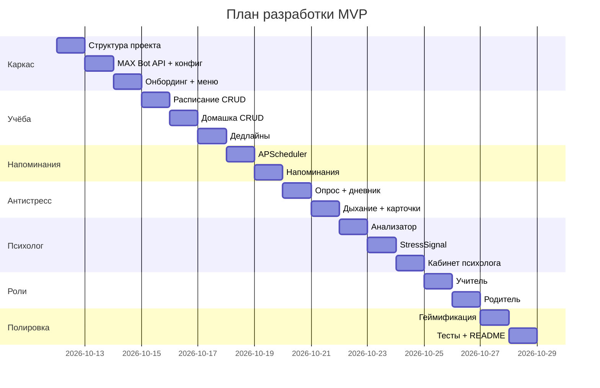

### Этап 1 — каркас
- [ ] Создать структуру проекта
- [ ] Подключить MAX Bot API, получить токен
- [ ] Настроить .env, конфиг, логи
- [ ] Поднять SQLite + SQLAlchemy + Alembic
- [ ] Команда /start + выбор роли
- [ ] Онбординг каждой роли
- [ ] Главное меню по ролям

### Этап 2 — учёба
- [ ] CRUD расписания
- [ ] Показ «сегодня / завтра / неделя»
- [ ] CRUD домашки
- [ ] Отметка «выполнено» + очки
- [ ] Дедлайны контрольных

### Этап 3 — напоминания
- [ ] APScheduler
- [ ] Напоминания об уроках
- [ ] Напоминания о дедлайнах
- [ ] Ежедневный опрос настроения

### Этап 4 — антистресс
- [ ] Опрос настроения
- [ ] Дневник настроения
- [ ] Дыхательные практики
- [ ] Антистресс-карточки
- [ ] Чат с ИИ-ботом

### Этап 5 — психолог
- [ ] Анализатор сообщений
- [ ] Проверка порога
- [ ] Предложение помощи
- [ ] Создание StressSignal
- [ ] Кабинет психолога

### Этап 6 — роли учителя и родителя
- [ ] Кабинет учителя
- [ ] Кабинет родителя
- [ ] Связи между ролями

### Этап 7 — геймификация и полировка
- [ ] Начисление очков
- [ ] Кастомизация
- [ ] Тексты, кнопки, эмодзи
- [ ] Обработка ошибок
- [ ] Тесты
- [ ] README + инструкция запуска

---

## 16. Принцип продукта

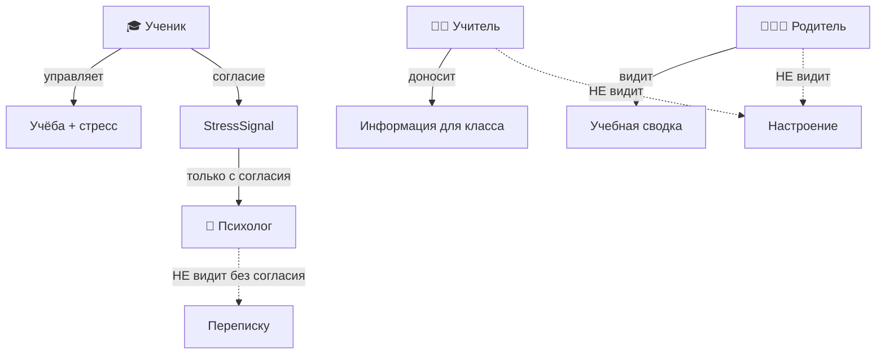

> Ученик управляет учёбой и стрессом.  
> Учитель доносит информацию до класса.  
> Родитель видит учебную картину — без слежки.  
> Сигнал о стрессе идёт только школьному психологу и только с согласия ребёнка.
